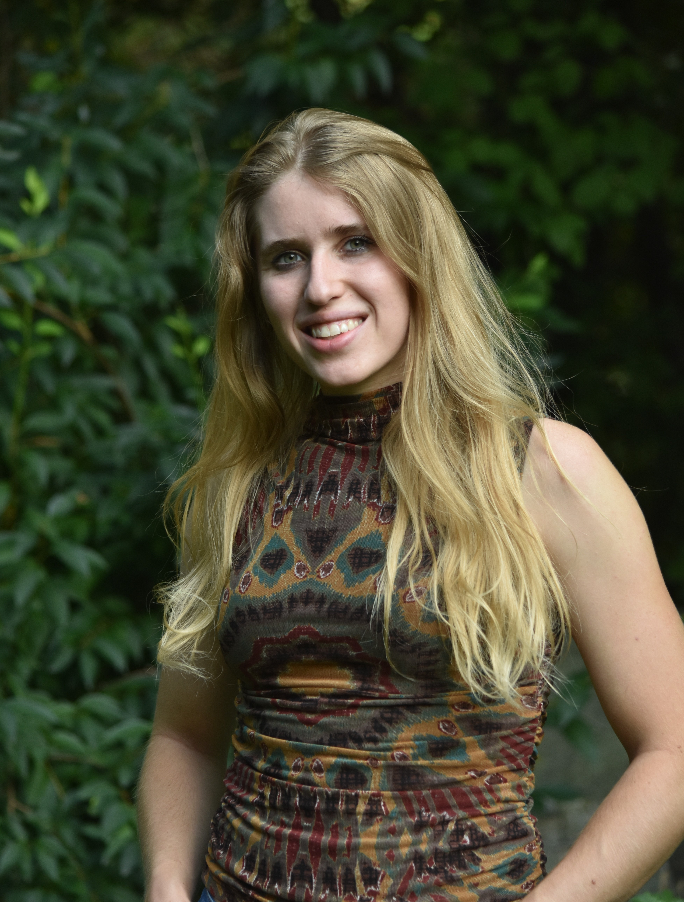

::: {.about-intro}

::: {.about-image}

{.about-photo}

:::

::: {.about-text}

I am a PhD candidate and HHMI Gilliam Fellow in the [Marler Lab](https://marlerlab.psych.wisc.edu/) at the University of Wisconsin–Madison. I study how internal physiological states shape social decision-making. Using approaches from behavioral neuroscience and neuroimmunology in monogamous California mice, my research explores how immune signaling, social environments, and functional neuroplasticity interact to shape behavior. Ultimately, I aim to understand how the immune system acts not simply in response to disease, but as an active regulator of social behavior.

:::

:::

I received my B.S. from the University of Wisconsin–Madison. As an undergraduate in Dr. David Abbott's lab, I studied how the menstrual cycle influences prosocial decision-making in rhesus macaques. This work sparked my interest in how peripheral physiological systems contribute to complex social behavior and ultimately led me to investigate interactions between the immune system, brain, and social environment.

As I move into the next stage of my research, I am interested in extending my work on the bidirectional relationship between immune function and social behavior to broader, ecologically relevant contexts. I want to understand how animals adapt their behavior to the diverse immune and environmental challenges they encounter in natural environments. At the cellular level, I am interested in how microglia interact with neural circuits to adaptively modify behavior in response to these challenges. At the social level, I want to explore how environmental and immune challenges experienced by individuals can propagate through social groups and reshape social networks. By connecting processes across these scales, I hope to understand how neuroimmune mechanisms contribute to adaptive behavior in complex social and ecological environments.

## Contact Me

I am always happy to connect about research, collaboration, or shared scientific interests.

**Email:** [erhammond@wisc.edu](mailto:erhammond@wisc.edu)

[Google Scholar](https://scholar.google.com/citations?hl=en&user=ldRPjp4AAAAJ&view_op=list_works&sortby=pubdate) • [ResearchGate](https://www.researchgate.net/profile/Emma-Hammond-5)