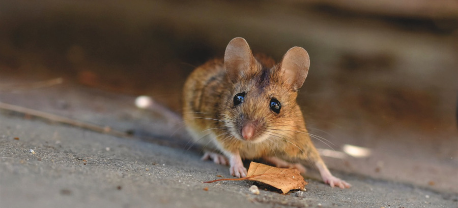
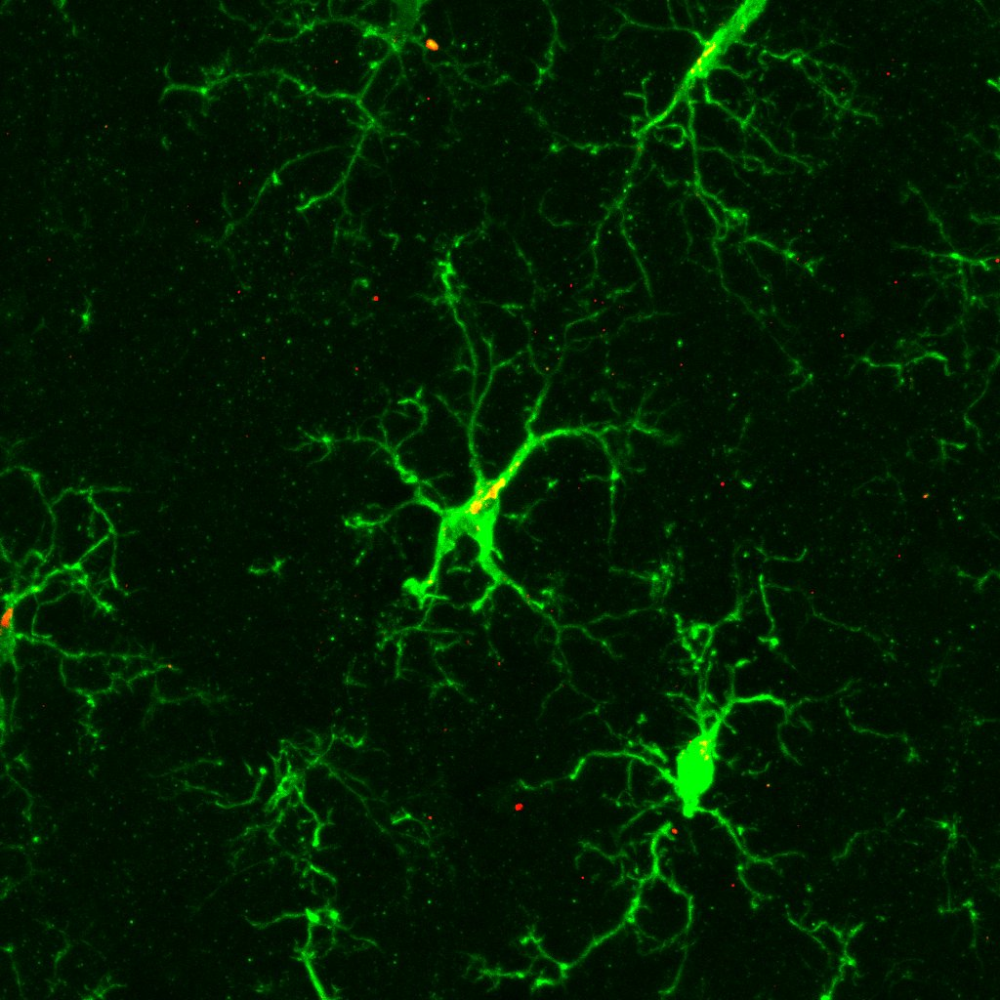

:::::: hero-text
# Emma Hammond {.hero-name}

::: hero-affiliation
University of Wisconsin–Madison • HHMI Gilliam Fellow
:::

::: hero-keywords
Behavioral Neuroscience • Neuroimmunology • Social Behavior • Ecoimmunology
:::

::: hero-buttons
[Research](research.qmd){.btn .btn-primary} [CV](cv.qmd){.btn .btn-outline-primary}
:::
::::::

:::: hero-image
::: hero-image-pair
{.research-photo}

{.research-photo}
:::
::::
