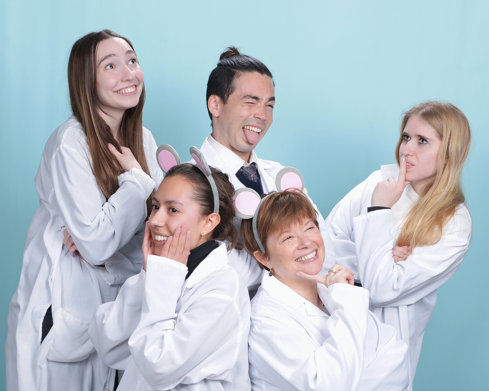

::: publications-photo
{width="2000"}
:::

## Research Publications

### 2026

[**Affiliative behavioural phenotype and microglial activation predict social decision-making following immune activation.**](https://doi.org/10.1016/j.bbr.2026.116194)\
**Emma R. Hammond**, Patrick K. Monari, Elsa M. Luebke, Aimee K. Johnson, Anthony P. Auger, & Catherine A. Marler.\
*Behavioural Brain Research, 507*, 116194.

### 2025

[**Sex differences in structural and receptor mRNA expression in the ventral anterior cingulate cortex and a potential role of perineuronal nets in monogamous pair bond establishment (*Peromyscus californicus*).**](https://doi.org/10.1186/s13293-025-00741-4)\
Candice L. Malone, Jiaxuan Li, Elsa M. Luebke, Leykza Carreras-Simons, Warren W. Treis, **Emma R. Hammond**, Patrick K. Monari, & Catherine A. Marler.\
*Biology of Sex Differences, 16*, 58.

[**Oxytocin impairs wound-healing during social isolation but not social living.**](https://doi.org/10.1016/j.psyneuen.2025.107445)\
**Emma Hammond**, Patrick Monari, Lila Kilponen, Yiru Chen, Anthony Auger, & Catherine Marler.\
*Psychoneuroendocrinology, 176*, 107445.

### 2024

[**Conditioned preferences: Gated by experience, context, and endocrine systems.**](https://doi.org/10.1016/j.yhbeh.2024.105529)\
Patrick K. Monari, Xin Zhao, **Emma R. Hammond**, Alyse N. Maksimoski, Radmila Petric, Candice Malone, Lauren V. Riters, & Catherine A. Marler.\
*Hormones and Behavior, 161*, 105529.

### 2022

[**Neuroendocrine mechanisms of aggression in rodents.**](https://doi.org/10.1037/mot0000260)\
Nathaniel S. Rieger, Caleigh D. Guoynes, Patrick K. Monari, **Emma R. Hammond**, Candice L. Malone, & Catherine A. Marler.\
*Motivation Science, 8*(2), 81–105.

## Perspectives & Op-Eds

### 2025

[**A Guide to Building and Sustaining Antiracist Learning-Action Communities in Academia.**](https://doi.org/10.1525/collabra.130032)\
Patrick K. Monari\*, **Emma R. Hammond**\*, Michelle Marji, Benjamin D. Douglas, Duncan M. Cleveland, Candice L. Malone, & The ALAN Community.\
*Collabra: Psychology, 11*(1), 130032.

\* Equal contribution.

### 2023

[**Leveraging individual power to improve racial equity in academia.**](https://doi.org/10.1016/j.yhbeh.2023.105358)\
Patrick K. Monari\*, **Emma R. Hammond**\*, Candice L. Malone\*, Amelia Cuarenta\*, Lisa C. Hiura\*, Kelly J. Wallace\*, Linzie Taylor\*, & Devaleena S. Pradhan\*.\
*Hormones and Behavior, 152*, 105358.

\* Equal contribution.
