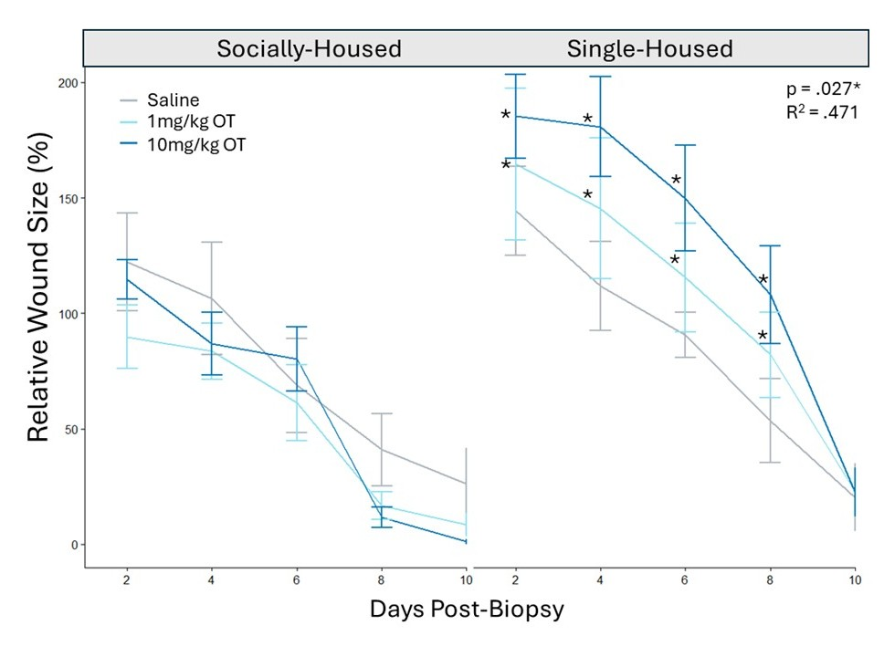
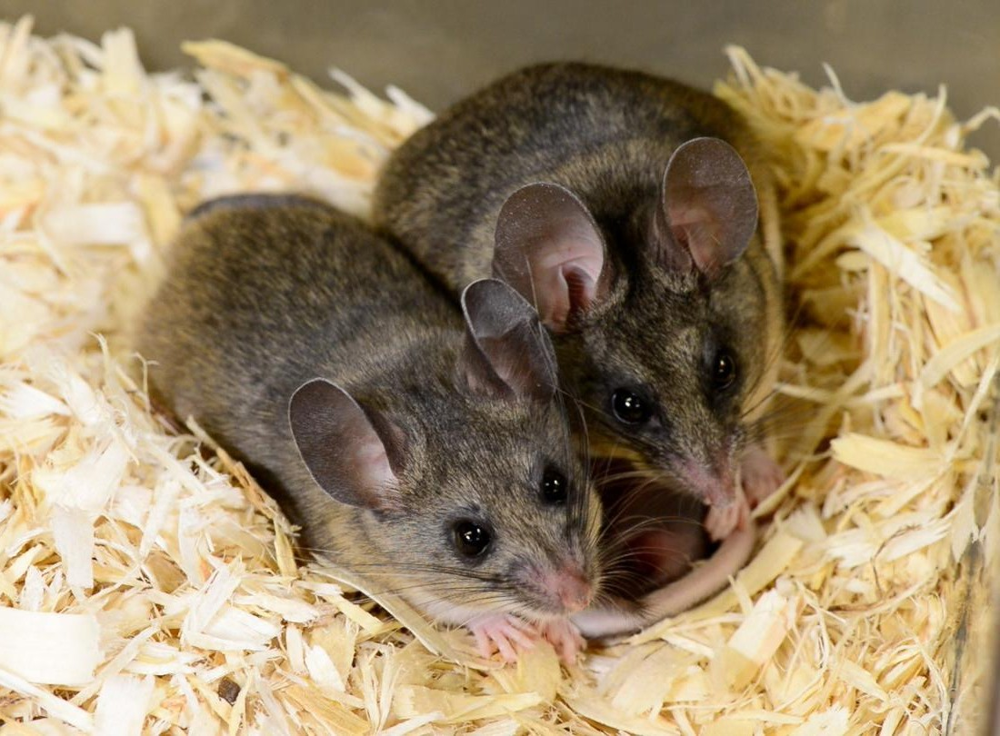
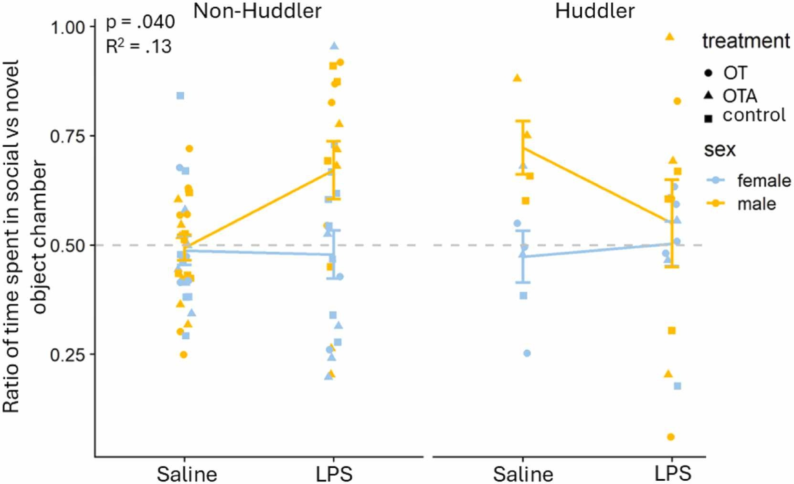
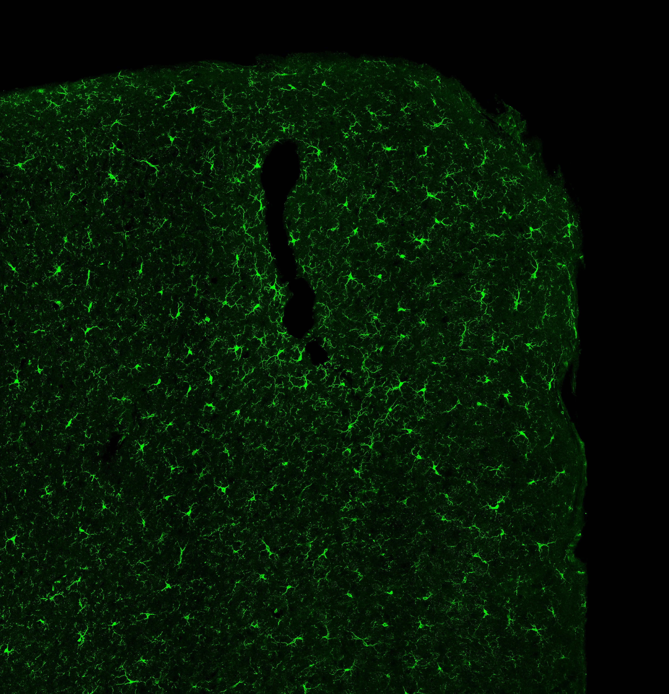
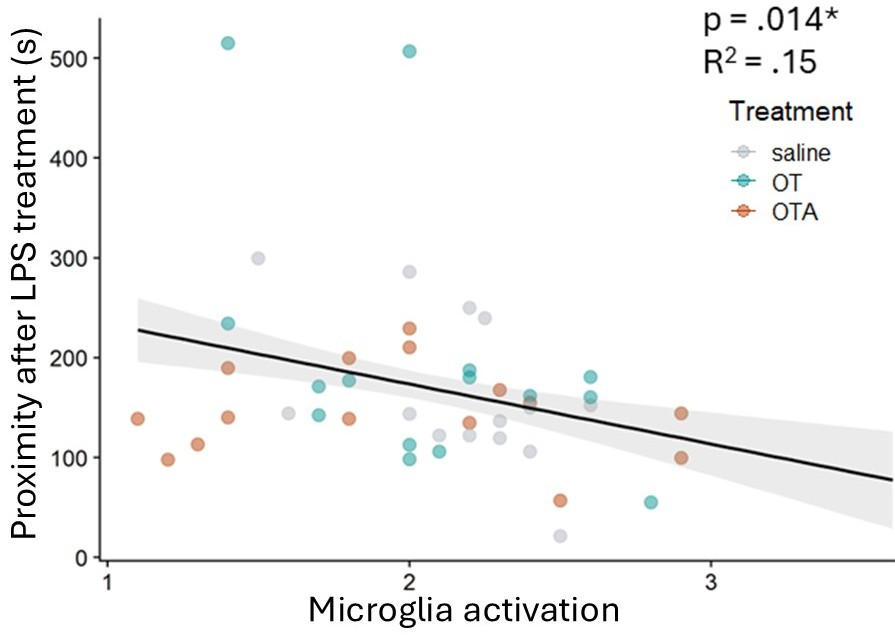

Though social behavior and immune function have historically been studied separately, there is increasing evidence to demonstrate how inextricably linked these two systems are. My research has focused on the bidirectional relationship between social behavior and the immune system, and the mechanistic link between the two.

## How does the social environment shape responses to immune challenges?

Social environments can both protect individuals from immune challenges and create unique risks. For animals living in social groups, relationships with conspecifics can provide access to resources, protection from predators, and social support. At the same time, increased social contact can increase exposure to pathogens. How, then, does the immune system adapt to different social environments?

I have explored this question by examining wound healing in California mice living in social versus isolated conditions and investigating whether oxytocin—a hormone closely associated with social relationships—contributes to this response. I found that oxytocin impaired wound healing in socially isolated individuals, but not in socially housed individuals. These findings suggest that the physiological effects of oxytocin depend on an individual's social environment and highlight one mechanism through which social context may shape immune function.

[Read the paper →](https://doi.org/10.1016/j.psyneuen.2025.107445){.research-paper-link}

::: research-image-pair
{.research-photo}

{.research-figure}
:::

────────────────────────────────

## How does the immune system shape social behavior?

Immune activation can alter social behavior in diverse and context-dependent ways. Although sickness has traditionally been associated with social withdrawal, animals do not always respond to an immune challenge by avoiding others. In social species, immune activation can instead increase affiliation, depending on factors such as the relationship between individuals, social status, and the nature of the immune challenge. What determines whether an animal withdraws from others or seeks social contact when its immune system is activated?

I addressed this question by examining how California mice alter their social decisions following an inflammatory challenge with lipopolysaccharide (LPS). Rather than producing a uniform decrease in social behavior, the response depended on the animals' existing social phenotype. In males, individuals that were less affiliative prior to immune challenge showed the greatest subsequent increase in affiliation. These findings suggest that sickness behavior is not a fixed behavioral program, but instead depends on an individual's social history and current social context.

[Read the paper →](https://doi.org/10.1016/j.bbr.2026.116194){.research-paper-link}

::: research-image-pair
{.research-photo}

{.research-figure}
:::

────────────────────────────────

## What biological mechanisms link the social and immune systems?

The reciprocal relationship between social behavior and immune function raises a fundamental mechanistic question: **how does information about the social environment reach the immune system, and how does immune activity ultimately influence the neural circuits that regulate social behavior?**

My research investigates this interface through two candidate mechanisms: oxytocin signaling and microglia. Although oxytocin is best known for its role in social behavior, it also interacts extensively with the immune system and is released during inflammatory challenges. My work demonstrates that its effects on immune function depend on social context: during social isolation, oxytocin can impair wound healing rather than promote recovery.

I also investigate microglia, the resident immune cells of the brain, as a potential pathway through which peripheral immune activity can influence social behavior. I found that greater microglial activation in the medial prefrontal cortex was associated with reduced social proximity following an inflammatory challenge. My current work moves from correlation toward causation by experimentally manipulating microglia both broadly and within the prefrontal cortex. By determining whether altering microglial function changes social responses to immune challenge, I aim to identify a mechanistic bridge between immune state, neural function, and social behavior.

::: research-image-pair
{.research-photo}

{.research-figure}
:::
